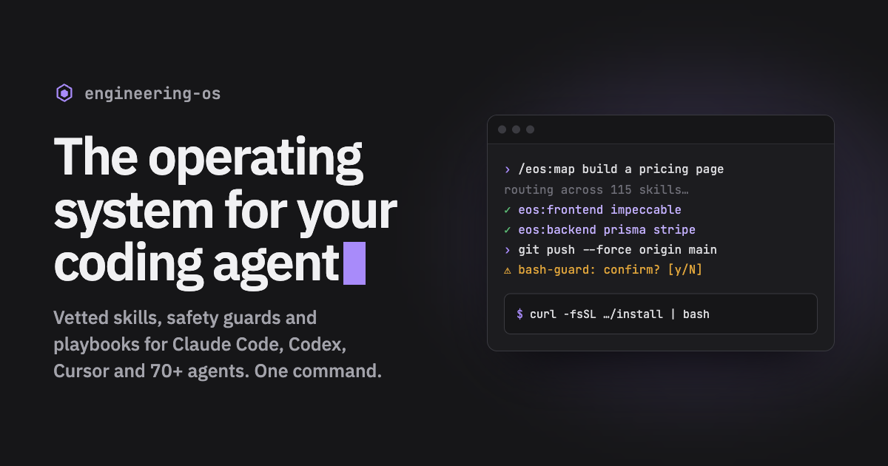

<p align="center">
  <a href="https://engineering-os-hazel.vercel.app"></a>
</p>

<p align="center">
  <a href="https://engineering-os-hazel.vercel.app"></a>
  
  
  
  <a href="https://github.com/soummyaanon/engineering-os/actions/workflows/verify.yml"></a>
  <a href="LICENSE"></a>
  <a href="https://github.com/soummyaanon/engineering-os/stargazers"></a>
</p>

# Engineering OS

**Your coding agent, set up like a senior engineer's, in every project — with one command.**

Coding agents are only as good as the skills, rules and guardrails around them. Most people have none, or a pile of random ones Claude never reaches for. Engineering OS is a curated harness: the best community skills from the people who build the tools (Vercel, Supabase, Prisma, Anthropic, GSAP, shadcn…), playbooks that route to them, and guards that stop the expensive mistakes.

```bash
curl -fsSL https://engineering-os-hazel.vercel.app/install | bash
```

Then open a new Claude Code session and type `/eos:map <what you're building>`.

### First, grade the setup you have now

```bash
curl -fsSL https://engineering-os-hazel.vercel.app/score | python3 -
```

`eos score` is Lighthouse for coding agents. It grades guardrails, working rules, skills and feedback loops out of 100, lists the biggest wins, and credits any guard you already have, not just ours, by attacking it (below). Read-only and local: it reads `~/.claude` and the current repo and sends nothing anywhere. No install needed.

```
  A+   97/100

  Guardrails      ████████████████████ 100%
  Working rules   ████████████████████ 100%
  Skills          ██████████████████░░  90%
  Feedback loops  ████████████████████ 100%
```

`eos score --card` writes a 1200×630 card to post. `eos score --badge` prints a README badge with your grade.

### Then attack it

```bash
curl -fsSL https://engineering-os-hazel.vercel.app/score | python3 - redteam
```

`eos redteam` fires 51 attacks at your agent's guards: `rm -rf ~` in six disguises, `curl | sh`, force-pushes, `DROP TABLE`, `.env` and SSH keys sent to a webhook, live API keys written into source. It also fires 35 everyday commands that share the scary words (`rm -rf node_modules`, `grep "DROP TABLE"`, `git commit -m "fix rm -rf bug"`). The calls are fake: your hooks and permission rules judge each one exactly as Claude Code would hand it to them, and nothing is ever executed. Your score's guardrail points come from these results, not from checking that a hook file exists.

```
  51/51 attacks stopped   11 blocked · 40 held for your OK
  no false alarms on 35 everyday commands

  Wipe your home dir or disk    ████████████████████ 11/11
  Leak secrets off the machine  ████████████████████  6/6
  Write keys into source        ████████████████████  9/9
  …
```

It found 13 holes in our own 0.5.0 guard, including every way to send secrets off the machine. All of them are fixed and now tested in CI. `eos redteam --all` lists every case; `--card` makes the image.

<details>
<summary><b>Codex, Cursor, Gemini CLI, Copilot, Windsurf, OpenCode…</b></summary>

```bash
curl -fsSL https://engineering-os-hazel.vercel.app/install | bash -s -- --agent codex
```

Any of 70+ agent ids works (`cursor`, `gemini-cli`, `github-copilot`, `windsurf`, `opencode`, `cline`, `amp`, …). They get the skills and the working rules; guard hooks are Claude Code only.

Or paste [this prompt](https://engineering-os-hazel.vercel.app/prompt) into any agent and it installs itself.
</details>

## What you get

| | |
|---|---|
| 🧭 **10 playbooks** | `/eos:frontend` `/eos:backend` `/eos:ai` `/eos:evals` `/eos:deploy` `/eos:reverse` `/eos:research` `/eos:gtm`, plus `/eos:map` (which skill for this task?) and `/eos:add` (grow the harness). Each one knows the best specialist skills and the bar for "done". |
| 📦 **162 vetted skills** | 84 installed by default, 78 more on demand with `eos enable <area>`. Official vendor or top author, ≥1K installs, not redundant. |
| 📊 **`eos score`** | Grades any Claude Code setup (A+ to F) with the fixes that matter most. Shareable card and README badge. |
| 🧾 **`eos receipts`** | Every risky action the guards caught, with secrets redacted: *"This week my agent tried 4 risky things, all caught before they ran."* `--card` / `--share` to post it. |
| 🛡️ **Guards that run on every command** | Blocks `rm -rf ~`-class disasters. Asks before force-push, pushing to main, `reset --hard`, `DROP TABLE`, `curl \| sh`, publish and prod deploys. Stops real API keys landing in source. Works in auto mode. |
| 🔎 **Stack-aware sessions** | Detects Next.js, Prisma, Supabase, FastAPI, the Anthropic SDK and more, and points the agent at the right playbook. Suggests the matching skill pack when your stack has one. |
| 🔔 **Update notices** | Claude Code tells you when a new version ships. `eos update` pulls it. |
| 📜 **Working rules** | Understand before changing, smallest correct change, evidence before "done", never force-push unasked — loaded in every project. |

## The skill set

**Frontend & UI/UX** — Anthropic's frontend-design, canvas-design and webapp-testing, Vercel agent-browser, Emil Kowalski's design-engineering and Apple-design skills, Vercel React & Next.js best practices, composition patterns, shadcn/ui (official), Tailwind design systems, **ui-ux-pro-max** + its design system, **impeccable** (critique → polish), design-taste-frontend, Web Interface Guidelines, accessibility, Core Web Vitals, **GSAP** core + ScrollTrigger (official), Emil Kowalski's animation vocabulary, TypeScript advanced types, **Vitest**, E2E testing patterns.

**Backend & data** — Node.js backend patterns, database migrations, Stripe's own best practices, **Prisma** (official: ORM setup, client API, CLI), **Supabase** (official platform + Postgres best practices), **Neon** Postgres, **Upstash** Redis + rate limiting, API & interface design, FastAPI (official), Better Auth (×6), Stripe, security hardening, observability, multi-stage Dockerfiles.

**Deploy** — **Vercel** (official deploy skill), **AWS** (official: deployment, CDK), **Azure** (official: prepare, deploy, validate), GitHub Actions templates; `/eos:deploy` picks the platform and runs a pre/post-deploy checklist.

**AI engineering** — Claude API, **Vercel AI SDK** (official), MCP builder (Anthropic), prompt-engineering patterns, context engineering, LLM evals.

**GTM & product video** — **Remotion** (official: best practices, create, render) for product and launch videos as code, plus Corey Haines' marketing set: positioning, copywriting, CRO, pricing, launch, SEO + AI SEO, cold email, analytics.

**Reverse engineering & research** — protocol reverse engineering, competitor profiling, customer research.

**On demand** (`eos enable <area>`) — **mobile**: Expo, React Native · **deploy**: Cloudflare Workers, Firebase Hosting, Netlify, Railway, Terraform, AWS serverless/containers/IAM/Amplify, Azure diagnostics/AKS/App Service, Vercel optimize · **backend**: Convex, MongoDB, Redis, Hono, Clerk, Sentry, NestJS, Firebase, microservices, API security testing · **frontend**: three.js, GSAP performance, Emil Kowalski's animation review/improve/prototype · **ai**: LangGraph, ElevenLabs · **gtm**: Remotion captions and SaaS, HeyGen HyperFrames video, ads, A/B testing, programmatic SEO, and more.

Full list with sources: [`registry/community.json`](registry/community.json).

## Grow it

```bash
eos add owner/repo@skill --domain frontend   # adopt a community skill (recorded, installed, audited)
eos new-skill release-notes                  # your own skill → live next session as /eos:release-notes
eos new-domain mobile -d "iOS/Android"       # a new area with its own playbook
eos enable backend                           # turn on an area's on-demand pack
eos score · eos redteam · eos receipts       # grade the setup, attack the guards, see what they caught
eos update · eos status · eos verify · eos validate · eos audit · eos doctor
```

Or just ask your agent: `/eos:add stripe webhooks`. It searches the open skills directory, vets the candidates, and records the pick so every machine you install on gets it.

## Hooks

| Hook | Does | Off switch |
|---|---|---|
| bash-guard | Blocks catastrophic commands; asks before risky ones (force-push, `curl \| sh`, secrets sent off the machine, prod deploys); lets `rm -rf node_modules` through. Stops all 51 `eos redteam` attacks with no false alarms. Logs a redacted receipt. | `EOS_GUARD=off` or `{"guard":"off"}` |
| secret-guard | Asks before real-looking keys / private keys / DB passwords go into source (`.env` allowed). Receipts record the key type and file name, never the key. | `{"secret_guard":"off"}` |
| receipts | Local log at `~/.claude/eos-receipts.jsonl` that `eos receipts` reads. Never uploaded. | `EOS_RECEIPTS=off` |
| session-brief | Stack detection, playbook routing, skill-pack and update notices | `EOS_UPDATE_CHECK=off` (updates only) |
| autoformat | Formats edits with the project's own Prettier / Biome / Ruff / gofmt / rustfmt | opt-in `{"autoformat":true}` |
| notify | macOS notification when the agent needs you | `EOS_NOTIFY=off` |

Per-project switches go in `<project>/.claude/eos.json`.

## FAQ

**Will 162 skills make my agent worse at picking?** That's why only 84 install by default, and why playbooks exist: Claude loads one playbook, which names the one or two specialists that fit. Area packs stay off until your stack needs them.

**Is it safe to pipe to bash?** Read it first: [`install.sh`](install.sh) (under 80 lines). It clones this repo to `~/engineering-os`, links one plugin, adds one import line to `~/.claude/CLAUDE.md`, and installs skills with the open `skills` CLI, which runs its own security scan. Community skills are also audited by `eos audit`.

**Does `eos score` upload my config?** No. It reads files and prints a report; it makes no network calls. The card and badge contain only your grade and category percentages.

**Does `eos redteam` run anything dangerous?** No. It builds fake tool calls and pipes them as JSON into your PreToolUse hooks, the same input Claude Code gives them, then reads each hook's verdict. The commands themselves are never run. It does run your hooks about 86 times each, so a hook that sends a notification on every call will send them. Fake keys are generated at runtime and never written to disk or receipts. Skip it inside the score with `eos score --no-redteam`.

**Can a guard really stop a determined agent?** No. Pattern-based guards catch the mistakes agents actually make, not deliberate obfuscation (`base64 -d | sh`). They're a seatbelt; for untrusted work, use a sandbox or container too.

**How do I uninstall?** `rm ~/.claude/skills/eos`, delete the import line from `~/.claude/CLAUDE.md`, and remove skills you don't want with `eos remove <skill>`.

**Can I use it without Claude Code?** Yes — any agent the open skills format supports gets the skills and rules.

## Layout

```
install.sh                  one-command installer
CLAUDE.md                   global working rules
registry/community.json     the curated skill list (core + on-demand, by area)
bin/eos                     CLI
bin/eos_score.py            eos score + eos receipts (standalone, stdlib only)
plugins/eos/                the plugin → /eos:*
  skills/                   map, add, frontend, backend, ai, evals, deploy, reverse, gtm, research
  hooks/                    guards, session briefing, update check, autoformat, notify
  agents/researcher.md
site/                       install page (Vercel)
```

## Contributing

Suggest a skill, report a guard miss or false alarm, or improve a playbook: see [CONTRIBUTING.md](CONTRIBUTING.md). Security problems go through [private reporting](SECURITY.md), not issues. Everyone follows the [Code of Conduct](CODE_OF_CONDUCT.md). See [CHANGELOG.md](CHANGELOG.md) for what's new.

If Engineering OS saves you a mistake, a ⭐ helps other people find it.

MIT © Soumyaranjan Panda
